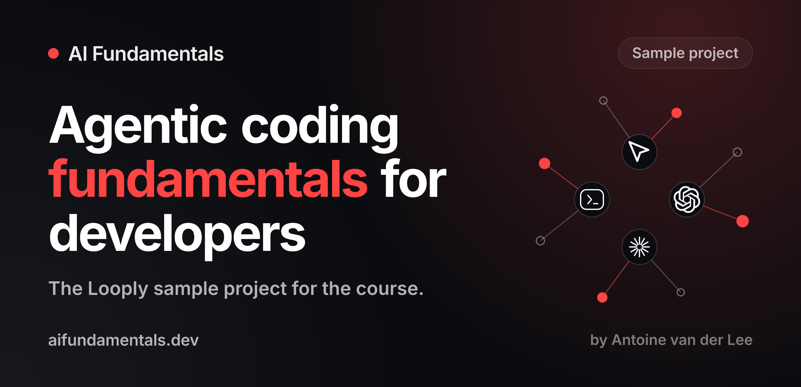

# AI Fundamentals: Sample Project

The practical companion to the [AI Fundamentals course](https://aifundamentals.dev), a tool-agnostic course that teaches you a stable way of working with AI agents: clear context, reliable instructions, and validation loops that reduce risk, tech debt, and confusion.

This repository contains the sample project you apply the lessons to. It's optional, but it gives you a safe space to practice, compare your results, and report feedback.

## The sample project

The project is the landing page of **Looply**, a fictional habit-tracking app. It's built with plain HTML, CSS, and JavaScript, so there's no framework to learn and nothing to install besides the agent tool you want to use. Every developer has a browser, and that's all you need.

The repository contains two versions of the same page:

| Folder | What it is |
| --- | --- |
| `starter/` | The version you begin with. It works, but it has rough edges: weak copy, missing metadata, accessibility issues, and no agent instructions. Finding and fixing those is part of the course. |
| `final/` | The improved version, with better copy and structure, proper metadata, an `AGENTS.md` file, and reusable agent skills in `.agents/skills/`. Use it to compare your own results. |

Your result will not match `final/` exactly, and that's expected. Agents rarely produce the same output twice, and your decisions shape the outcome. What matters is whether your version meets the review criteria from the lessons.

## Getting started

1. Clone the repository or download it as a ZIP file.
2. Open `starter/index.html` in your browser, or run `npm start` inside `starter/` if you have Node.js installed.
3. Open the **`starter/` folder** (not the repository root) in your agent tool. Otherwise, your agent also sees `final/` and works towards the answer.
4. Follow the exercises in the course lessons.

The lessons also recommend starting your own Git repository from the `starter/` folder. That lets you commit as often as you like and undo anything your agent changes.

## Works with any agent tool

The course doesn't teach one tool. Use Cursor, Codex, Claude Code, or any other agent you prefer. The lessons explain what to ask your agent and what to look for in the result, and your tool of choice handles the rest.

## Requirements

- A modern browser.
- An agent tool of your choice.
- [Node.js](https://nodejs.org) (optional) if you prefer `npm start` over opening the HTML files directly.

## Feedback

Found a typo, an error, or something unclear in a lesson or in the sample project? [Open an issue](https://github.com/AvdLee/AI-Fundamentals-Course/issues/new/choose) using the lesson feedback template. I use your feedback to improve the course along the way, and you can leave your name to be credited in the changelog.

See the [changelog](CHANGELOG.md) for updates to this repository.

## Stay updated

Course students get an email whenever the course changes. To get the most out of your learning, you can also follow me on [X](https://twitter.com/twannl), [Bluesky](https://bsky.app/profile/avanderlee.com), and [LinkedIn](https://www.linkedin.com/in/ajvanderlee/), or read [SwiftLee](https://www.avanderlee.com) for more articles on development with AI.

## License

This project is licensed under the [MIT License](LICENSE). You're free to use the code and the agent instructions in your own projects.

---

Created by [Antoine van der Lee](https://www.avanderlee.com).
